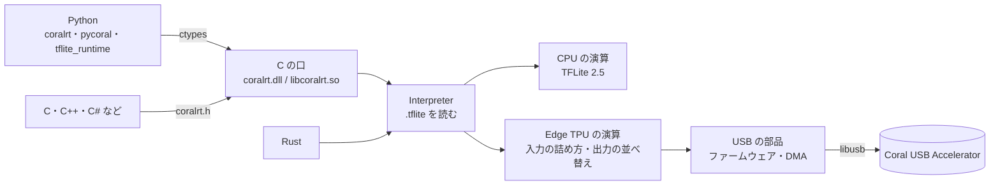

<div align="center">

# coralrt

### Coral USB Accelerator を libedgetpu・tflite_runtime・pycoral なしで動かす実行部品

[](Cargo.toml)
[](python/pyproject.toml)
[](include/coralrt.h)
[](https://coral.ai/products/accelerator/)
[](LICENSE)

**pycoral 2.0 と同じ出力を、今の Python・Rust・C から**

[English](README_en.md)

---

</div>

## 概要

公式の pycoral は Python 3.9 までしか動きません。coralrt はその代わりに、Coral USB Accelerator(Edge TPU)で `*_edgetpu.tflite` を動かす部品を Rust で書き直したものです。USB の部品、Edge TPU の演算、TensorFlow Lite 2.5 の CPU の演算を、すべて自前で持っています。

Python からは、pycoral や tflite_runtime と同じ名前のまま使えます。pycoral 向けに書いたコードは書き換えずに動きます。C の口があるので、C・C++・C#・Go・Node など FFI のある言語からも呼べます。

Google の公式のものではありません。

## 特徴

| 項目 | 内容 |
| --- | --- |
| 公式と同じ出力 | Edge TPU の出力が、公式(pycoral 2.0、Windows)とバイト単位で同じ。4 つのモデル × 6 入力の 24 件を、Rust と Python の両方で確かめた |
| TFLite 2.5 の演算 | 組み込みの演算 135 個と、カスタムの演算 4 個(Mfcc・AudioSpectrogram・NumericVerify・TFLite_Detection_PostProcess)の全部。Windows 版の tflite_runtime 2.5 と 1925 件で突き合わせて、すべて一致した |
| 今の Python | Python 3.12・3.13・3.15、numpy 1 と 2 で確かめた。要るのは numpy だけ |
| pycoral の互換 | `pycoral.adapters`・`utils`・`pipeline`・`learn`(imprinting と backprop)、`tflite_runtime.interpreter` |
| C の口 | `include/coralrt.h` と `coralrt.dll` / `libcoralrt.so` |
| pip | `pip install coralrt` で入る。Windows x64 と Linux の x86_64・aarch64 の wheel で、DLL が中に入っている |
| 動作の確認 | Windows 11 と Linux(WSL2 の Ubuntu 24.04、usbipd-win で Coral を渡した)で、実機の Coral で確かめた。macOS は `cargo check` が通る所までで、実機では動かしていない |

整数の演算はバイト単位で同じです。浮動小数の畳み込みと行列積は、公式でも足す順が CPU の SIMD で変わるので、誤差 1e-5 の範囲で同じとしています。

### 速さ

公式と交互に 6 回 × 200 回測った中央値です(性能 High、ms)。

| モデル | 公式 | coralrt |
| --- | ---: | ---: |
| inception_v3 | 46.26 | 46.95 |
| mobilenet_v1 l2norm | 14.92 | 6.11 |
| 埋め込みの抽出 | 3.42 | 3.45 |
| 鳥の分類(mobilenet_v2) | 4.19 | 4.22 |
| MoveNet lightning | 10.51 | 9.67 |
| MoveNet thunder | 22.99 | 19.70 |
| SSD mobilenet_v2 | 11.57 | 11.70 |

## 処理フロー



## インストール

### 要るもの

| OS | 要るもの |
| --- | --- |
| Windows | 公式の [Edge TPU runtime](https://coral.ai/docs/accelerator/get-started/) を入れておく。coralrt はそれが入れる WinUSB のドライバ・UsbDk・`libusb-1.0.dll` を使う |
| Linux | `libusb-1.0-0`。手元では root でだけ確かめた。root 以外で使うには、機器に触れる権限(公式の runtime が入れる udev の規則など)が要る |
| ソースから作る時 | Rust 1.85 以降と、C のコンパイラ(FFT の C のファイルを組み込むため) |

### Python

```bash
pip install coralrt
```

wheel は Windows x64 と、Linux の x86_64・aarch64(glibc 2.28 以降)の 3 つです。

### ソースから作る

```bash
git clone https://github.com/cUDGk/coralrt.git
cd coralrt
cargo build --release
```

`target/release` に `coralrt.dll`(Windows)または `libcoralrt.so`(Linux)ができます。Python からこれを使うときは `pip install -e python` を流します。DLL 入りの wheel を作るときは `python python/build_wheel.py` を流すと、`python/dist` に wheel ができます。

## 使い方

### Python

pycoral のコードはそのまま動きます。

```python
from pycoral.utils.edgetpu import make_interpreter
from pycoral.adapters import classify, common

interpreter = make_interpreter("mobilenet_v2_1.0_224_inat_bird_quant_edgetpu.tflite")
interpreter.allocate_tensors()
common.set_input(interpreter, image)
interpreter.invoke()
print(classify.get_classes(interpreter, top_k=1))
```

tflite_runtime と同じ口の `coralrt.Interpreter` も使えます。

```python
from coralrt import Interpreter

it = Interpreter("model_edgetpu.tflite")  # device="usb:0", performance="max" も渡せる
it.set_tensor(it.get_input_details()[0]["index"], image)
it.invoke()
scores = it.get_tensor(it.get_output_details()[0]["index"])
```

### Rust

```rust
use coralrt::{Interpreter, Options};

let mut it = Interpreter::from_file("model_edgetpu.tflite", &Options::default())?;
it.set_input(0, &pixels)?;
it.invoke()?;
let scores = it.output(0)?;
```

### C

```c
#include "coralrt.h"

CoralInterpreter* it = coral_interpreter_new("model_edgetpu.tflite", NULL);
if (!it) { fprintf(stderr, "%s\n", coral_last_error()); return 1; }
coral_set_input(it, 0, pixels, n);
coral_interpreter_invoke(it);
coral_get_output(it, 0, scores, m);
coral_interpreter_free(it);
```

全体の見本は `examples/c/classify.c` にあります。

### 設定

| 設定 | 内容 |
| --- | --- |
| `performance` | `low`・`medium`・`high`・`max`。既定は `high`(公式の throttled と同じ 250 MHz)。`max` は公式の direct と同じ 500 MHz で、熱くなる |
| `device` | `usb`・`usb:N`・`usb:<path>`。既定は 1 本目 |
| `detection_sort` | 物体検出の後処理で、点数が同じ枠の並べ方。`tflite2.5`(既定、公式と同じ)か `stable`(TFLite 2.6 以降と同じ) |
| `CORALRT_PERFORMANCE` | `performance` を渡さなかった時の既定 |
| `CORALRT_LIBUSB` | 読む libusb の場所 |
| `CORALRT_LIB` | Python が読む coralrt のライブラリの場所 |

C では `coral_interpreter_new` の 2 つ目の引数に `"performance=max,device=usb:0"` のように渡します。

### 分かっている制限

- 分割したモデル(`pycoral.pipeline`)は、区切りごとに別の Coral を使う前提で作られています。1 本の Coral で動かすと、2 枚目の画像からは出力が全部 0 になります。公式の pycoral も同じです。Coral を 2 本使っての確認はしていません。
- Linux の aarch64(Raspberry Pi など)の wheel は、CPU のモデルで動くことまでしか確かめていません。Coral をつないでは試していません。
- macOS は、ビルドが通るところまでしか確かめていません。

## 試験

試験の台本は `tests/` にあります。台本は、coralrt のフォルダの隣に次のものがある前提で動きます(引数で別の場所も渡せます)。

```text
<作業のフォルダ>/
  coralrt/       このリポジトリ
  test_data/     python coralrt/tests/fetch_test_data.py で取る
  .venv/         公式の pycoral 2.0 を入れた Python 3.9(比べる元)
  .venv-rt315/   coralrt の Python の包みを入れた Python
  .venv-tf/      TensorFlow を入れた Python(演算の試験のモデルを作る)
```

| 台本 | 内容 |
| --- | --- |
| `tests/run_device_tests.ps1` | Coral が要る試験の全部。Edge TPU の出力を公式とバイト単位で比べ、C の見本・pycoral の見本・learn・pipeline・速さも見る |
| `tests/ops/` | 演算の試験。1 個の演算だけのモデルを作り、公式の tflite_runtime 2.5 と比べる |
| `tests/linux/` | WSL の Ubuntu でのビルド・演算の試験・wheel・Edge TPU の照合。WSL に Coral を渡す手順は `device.sh` の冒頭にある |
| `tests/mac/check.sh` | macOS 向けの `cargo check` |
| `tests/wheel_smoke.py` | 入れた wheel で分類と pipeline を動かす |

## Attribution

coralrt は、次のものを Rust に移すか、Python で書き直して作りました。どのファイルが何から来ているかは [NOTICE](NOTICE) にあります。

- [TensorFlow Lite 2.5](https://github.com/tensorflow/tensorflow)(Apache 2.0)
- [libedgetpu](https://github.com/google-coral/libedgetpu)(Apache 2.0)。Edge TPU のファームウェアも libedgetpu のものです
- [pycoral](https://github.com/google-coral/pycoral) と [libcoral](https://github.com/google-coral/libcoral)(Apache 2.0)
- [gemmlowp](https://github.com/google/gemmlowp)・[ruy](https://github.com/google/ruy)(Apache 2.0)
- [Microsoft STL](https://github.com/microsoft/STL)(Apache 2.0 with LLVM Exception)
- [Eigen](https://gitlab.com/libeigen/eigen)(MPL 2.0)
- [farmhash](https://github.com/google/farmhash)・[tinycoral](https://github.com/FrederikRogalski/tinycoral)(MIT)
- [Takuya Ooura の FFT](https://www.kurims.kyoto-u.ac.jp/~ooura/fft.html)

## ライセンス

[Apache License 2.0](LICENSE) です。ただし `src/ops/eigen.rs` は Eigen と同じ MPL 2.0 です。farmhash と tinycoral から来た部分は MIT で、その表示は [NOTICE](NOTICE) にあります。
