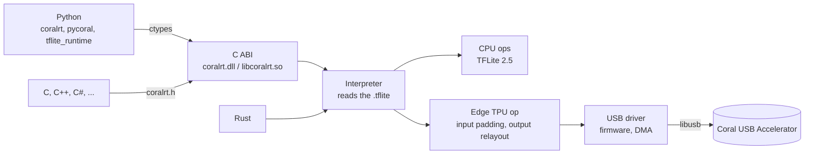

<div align="center">

# coralrt

### A runtime for the Coral USB Accelerator without libedgetpu, tflite_runtime or pycoral

[](Cargo.toml)
[](python/pyproject.toml)
[](include/coralrt.h)
[](https://coral.ai/products/accelerator/)
[](LICENSE)

**The same outputs as pycoral 2.0, from current Python, Rust and C**

[日本語](README.md)

---

</div>

## Overview

The official pycoral runs on Python 3.9 at the latest. coralrt replaces it: it runs `*_edgetpu.tflite` models on the Coral USB Accelerator (Edge TPU), rewritten in Rust. The USB driver, the Edge TPU op and the CPU ops of TensorFlow Lite 2.5 are all its own.

From Python it keeps the names of pycoral and tflite_runtime, so code written for pycoral runs unchanged. A C ABI makes it callable from C, C++, C#, Go, Node and any language with an FFI.

coralrt is not made or endorsed by Google.

## Features

| | |
| --- | --- |
| Same outputs | Edge TPU outputs are byte-identical to the official pycoral 2.0 on Windows: 24 cases (4 models × 6 inputs), from Rust and from Python |
| TFLite 2.5 ops | All 135 builtin ops and the 4 custom ones (Mfcc, AudioSpectrogram, NumericVerify, TFLite_Detection_PostProcess). 1925 cases checked against tflite_runtime 2.5 for Windows, all matching |
| Current Python | Checked on Python 3.12, 3.13 and 3.15 with numpy 1 and 2. numpy is the only dependency |
| pycoral compatible | `pycoral.adapters`, `utils`, `pipeline`, `learn` (imprinting and backprop), `tflite_runtime.interpreter` |
| C ABI | `include/coralrt.h` with `coralrt.dll` / `libcoralrt.so` |
| pip | `pip install coralrt`: wheels for Windows x64 and Linux x86_64 / aarch64, with the native library inside |
| Checked on | Windows 11 and Linux (Ubuntu 24.04 on WSL2, the stick passed through usbipd-win), with a real Coral. macOS: `cargo check` only, not run |

Integer ops match byte for byte. Float convolutions and matrix products are summed in an order that depends on the CPU's SIMD even in the official runtime, so they match within 1e-5.

### Speed

Medians of 6 × 200 runs, alternating with the official runtime (performance High, ms).

| Model | Official | coralrt |
| --- | ---: | ---: |
| inception_v3 | 46.26 | 46.95 |
| mobilenet_v1 l2norm | 14.92 | 6.11 |
| embedding extractor | 3.42 | 3.45 |
| bird classifier (mobilenet_v2) | 4.19 | 4.22 |
| MoveNet lightning | 10.51 | 9.67 |
| MoveNet thunder | 22.99 | 19.70 |
| SSD mobilenet_v2 | 11.57 | 11.70 |

## How it works



## Installation

### Requirements

| OS | Requirements |
| --- | --- |
| Windows | The official [Edge TPU runtime](https://coral.ai/docs/accelerator/get-started/). coralrt uses the WinUSB driver, UsbDk and `libusb-1.0.dll` it installs |
| Linux | `libusb-1.0-0`. Checked as root only; other users need access to the device (such as the udev rules the official runtime installs) |
| Building from source | Rust 1.85 or later, and a C compiler (for the FFT's C files) |

### Python

```bash
pip install coralrt
```

There are wheels for Windows x64 and for Linux x86_64 and aarch64 (glibc 2.28 or later).

### Building from source

```bash
git clone https://github.com/cUDGk/coralrt.git
cd coralrt
cargo build --release
```

`target/release` then has `coralrt.dll` (Windows) or `libcoralrt.so` (Linux). `pip install -e python` makes Python use it; `python python/build_wheel.py` builds a wheel with it inside, into `python/dist`.

## Usage

### Python

pycoral code runs as is.

```python
from pycoral.utils.edgetpu import make_interpreter
from pycoral.adapters import classify, common

interpreter = make_interpreter("mobilenet_v2_1.0_224_inat_bird_quant_edgetpu.tflite")
interpreter.allocate_tensors()
common.set_input(interpreter, image)
interpreter.invoke()
print(classify.get_classes(interpreter, top_k=1))
```

`coralrt.Interpreter` has tflite_runtime's API.

```python
from coralrt import Interpreter

it = Interpreter("model_edgetpu.tflite")  # device="usb:0", performance="max" optional
it.set_tensor(it.get_input_details()[0]["index"], image)
it.invoke()
scores = it.get_tensor(it.get_output_details()[0]["index"])
```

### Rust

```rust
use coralrt::{Interpreter, Options};

let mut it = Interpreter::from_file("model_edgetpu.tflite", &Options::default())?;
it.set_input(0, &pixels)?;
it.invoke()?;
let scores = it.output(0)?;
```

### C

```c
#include "coralrt.h"

CoralInterpreter* it = coral_interpreter_new("model_edgetpu.tflite", NULL);
if (!it) { fprintf(stderr, "%s\n", coral_last_error()); return 1; }
coral_set_input(it, 0, pixels, n);
coral_interpreter_invoke(it);
coral_get_output(it, 0, scores, m);
coral_interpreter_free(it);
```

A complete example is in `examples/c/classify.c`.

### Settings

| Setting | |
| --- | --- |
| `performance` | `low`, `medium`, `high` or `max`. Default `high` (250 MHz, the official throttled runtime). `max` is 500 MHz like the official direct runtime, and runs hotter |
| `device` | `usb`, `usb:N` or `usb:<path>`. Default: the first stick |
| `detection_sort` | How the detection post-processing orders boxes of equal score: `tflite2.5` (default, as the official runtime) or `stable` (as TFLite 2.6 and later) |
| `CORALRT_PERFORMANCE` | The default when `performance` is not given |
| `CORALRT_LIBUSB` | The libusb to load |
| `CORALRT_LIB` | The coralrt library Python loads |

From C, pass them as the second argument of `coral_interpreter_new`, like `"performance=max,device=usb:0"`.

### Known limits

- Segmented models (`pycoral.pipeline`) are made for one Coral per segment. On a single stick, outputs are all zeros from the second image on, with the official pycoral too. Two sticks have not been tried.
- Linux aarch64 (such as a Raspberry Pi): the wheel has been run on the CPU models only, not with a Coral.
- macOS: only the build has been checked.

## Tests

The scripts are in `tests/`. They expect these next to the coralrt folder (arguments can point elsewhere):

```text
<work folder>/
  coralrt/       this repository
  test_data/     from python coralrt/tests/fetch_test_data.py
  .venv/         Python 3.9 with the official pycoral 2.0 (the reference)
  .venv-rt315/   Python with coralrt's Python packages
  .venv-tf/      Python with TensorFlow (writes the op test models)
```

| Script | |
| --- | --- |
| `tests/run_device_tests.ps1` | Everything that needs the stick: Edge TPU outputs compared byte for byte with the official runtime, the C example, pycoral's examples, learn, pipeline and speed |
| `tests/ops/` | The op suite: one-op models, compared with the official tflite_runtime 2.5 |
| `tests/linux/` | Build, op suite, wheel and Edge TPU checks on Ubuntu in WSL. How to pass the stick to WSL is at the top of `device.sh` |
| `tests/mac/check.sh` | `cargo check` for macOS |
| `tests/wheel_smoke.py` | Classification and pipeline with an installed wheel |

## Attribution

coralrt was ported to Rust, or rewritten in Python, from the following. [NOTICE](NOTICE) says which file comes from which.

- [TensorFlow Lite 2.5](https://github.com/tensorflow/tensorflow) (Apache 2.0)
- [libedgetpu](https://github.com/google-coral/libedgetpu) (Apache 2.0), including the Edge TPU firmware
- [pycoral](https://github.com/google-coral/pycoral) and [libcoral](https://github.com/google-coral/libcoral) (Apache 2.0)
- [gemmlowp](https://github.com/google/gemmlowp), [ruy](https://github.com/google/ruy) (Apache 2.0)
- [Microsoft STL](https://github.com/microsoft/STL) (Apache 2.0 with LLVM Exception)
- [Eigen](https://gitlab.com/libeigen/eigen) (MPL 2.0)
- [farmhash](https://github.com/google/farmhash), [tinycoral](https://github.com/FrederikRogalski/tinycoral) (MIT)
- [Takuya Ooura's FFT](https://www.kurims.kyoto-u.ac.jp/~ooura/fft.html)

## License

[Apache License 2.0](LICENSE), except `src/ops/eigen.rs`, which is under MPL 2.0 like Eigen. The parts from farmhash and tinycoral are MIT; their notices are in [NOTICE](NOTICE).
